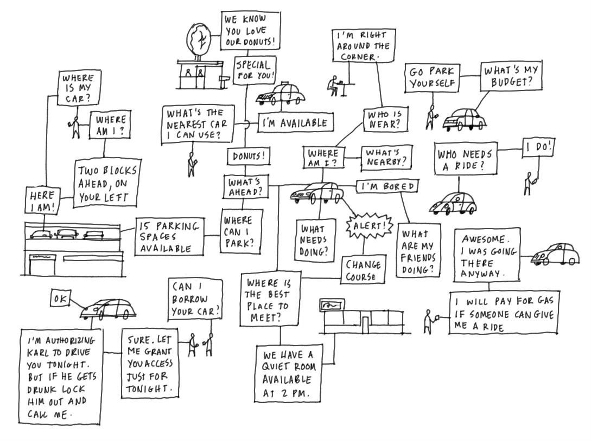
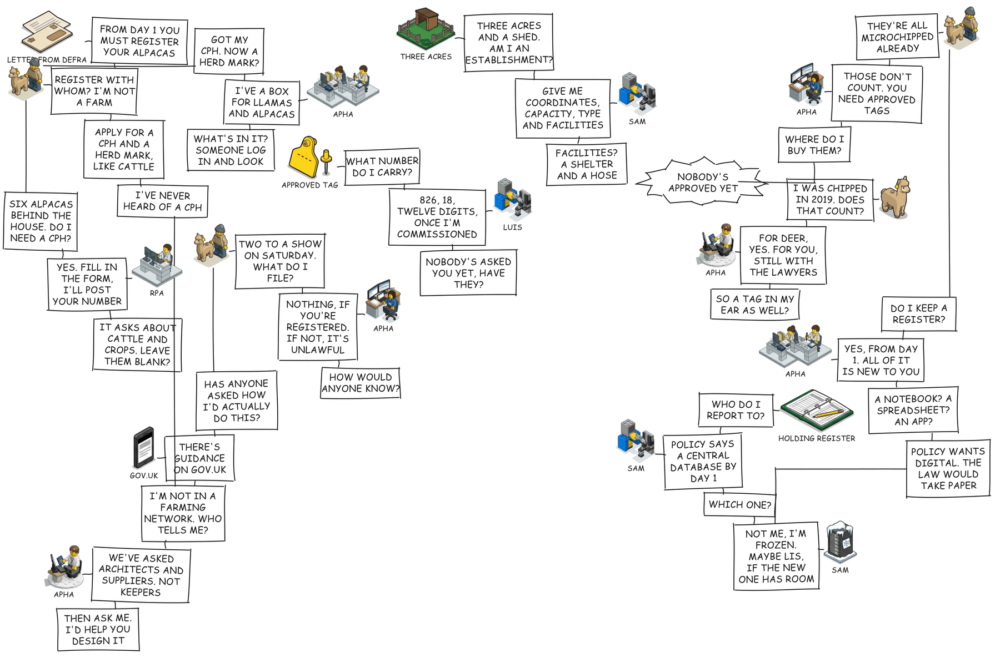
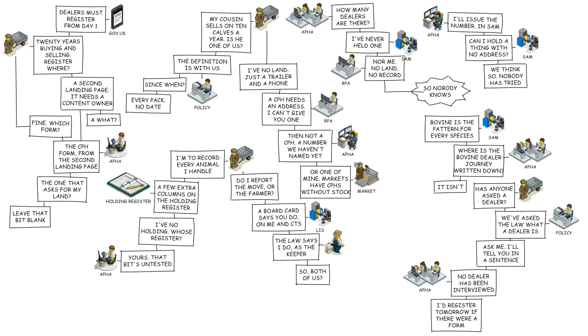

# Connected

A command-line tool that turns a screenplay-style text file into a hand-drawn **conversation map**: people, animals, places and systems talking to each other in boxes joined by plain lines, as if sketched with a marker on paper.

## Credit

This work is based on a drawing by [Dave Gray](https://www.linkedin.com/in/davegray/). I saw his connected car sketch, kept coming back to it, and wanted a way to make more like it. Everything here is an attempt to reproduce the feel of that one image.



The image is reproduced here without permission. It belongs to Dave Gray, and if he would rather it were not here it will be taken down.

## What it does

You write the conversations as a script:

```
@keeper   ?alpaca-keeper:tall once
@letter   ?letter                Letter from Defra

letter: From Day 1 you must register your alpacas
keeper: Register with whom? I'm not a farm
letter: Apply for a CPH and a herd mark, like cattle
keeper: I've never heard of a CPH
```

Each `@` line declares an actor and the icon that stands for them. A blank line starts a new thread. `build` composes each thread into a staircase of boxes, puts each speaker's icon beside their first turn, packs the threads onto a page and joins the few that need joining.

It writes two files: an Excalidraw file for finishing by hand, and a self-contained SVG with the font embedded. There is no graph layout engine. The layout is deliberately a bit untidy, and the Excalidraw file is there so you can drag things about until it reads well, then `pin` your changes so the next build keeps them.

## Why

The maps are for the people on a programme who do not do user research and are not sure why anyone should.

A service blueprint or a systems diagram shows a service from the inside. A conversation map shows one person from the outside, having every conversation the service makes them have. A stakeholder can read one in a minute, follow a single character across the page, and see where the answers run out. Nobody has to be told what the gap is.

The script format helps too. Writing a thread of three or four short lines forces you to say who is speaking, what they actually need to know, and who they would have to ask. A thread that cannot be written is usually a step nobody has designed. Comments above each thread record what the words rest on: the status of the assumption, and who has been consulted. When the answer to "asked:" is lawyers, architects and suppliers but never a keeper, that line does the persuading.

The payoff is a map that invites the question "shall we go and talk to one of them?" without anyone having to make the case for discovery.

## Examples

Both of these are real maps from a Defra programme, with names generalised. They were drawn for a cross-cutting show and tell in October 2026, one map per type of operator, to show what Day 1 of a new livestock regime would feel like from the operator's side. Both use the `lego` template, whose icons are Lego-style figures at their desks, in their paddocks and with their animals.

### The alpaca keeper

Six alpacas behind the house, and a letter saying they must be registered. Eleven threads follow the keeper through a CPH form designed for farms, a herd mark nobody has looked up, tags no manufacturer is approved to make, a database that may not exist yet, and a register that policy wants digital and the law would accept on paper. The last thread is the gap: nobody on the programme has spoken to a keeper.



Source: `examples/alpaca-keeper/scenario.txt`. Build it with:

```
node --import tsx src/cli.ts build examples/alpaca-keeper --png
```

### The livestock dealer

Twenty years buying and selling from a trailer and a phone, no premises, no CPH, and no record anywhere that the dealer exists. The dealer is the one operator GB has never registered, so every thread ends in something unowned: a landing page with no content owner, a definition still with policy, a number nobody has named, a form that asks for land. Again the last thread is the gap, and the hope: "I'd register tomorrow if there were a form."



Source: `examples/dealer/scenario.txt`. Build it with:

```
node --import tsx src/cli.ts build examples/dealer --png
```

Smaller examples live alongside these: `examples/clinic-appointment/` is made from a service blueprint, `examples/meat-export/` shows placeholder icons, and `examples/connected-car/` is a redrawing of the original.

Turning an existing diagram, a brief or a list of conversations into one of these, by hand or with an AI agent? Start with `docs/conversation-maps.md`. The file format is in `docs/scenario-format.md`. Design notes are in `BRIEF-v2.md`.

## Run

```
npm install
node --import tsx src/cli.ts build examples/govid-tax          # out/govid-tax.excalidraw and .svg
node --import tsx src/cli.ts build examples/connected-car --png   # also a PNG preview via sharp
node --import tsx src/cli.ts check examples/govid-tax          # parse, counts and warnings, no files
node --import tsx src/cli.ts pin examples/govid-tax            # record hand edits from out/govid-tax.excalidraw
node --import tsx src/cli.ts pin examples/govid-tax ~/Downloads/edited.excalidraw
node --import tsx src/cli.ts fixture                            # the hand-placed sketch used to tune the look
node --import tsx src/cli.ts preview out/some.svg               # rasterise any SVG
npm run typecheck
```

Open the `.excalidraw` file at excalidraw.com with Open, or drag it onto the canvas. Boxes carry their text, connectors stay bound when things are dragged, and captioned actors and bursts are grouped so they move as one.

## Worked example

`examples/govid-tax/` holds a scenario and a config:

```
@citizen  person
@phone    phone

citizen: Where do I start?
phone: Have you got photo ID?
```

Each `@` line declares an actor with an icon from the template and an optional caption. An icon that is not drawn yet can be a placeholder, `?vet:tall` or `?border-control-post:wide`, drawn as a labelled dashed box; `build` lists the placeholders left to draw and writes them to `out/placeholders/`. A blank line separates threads. `!` before a speaker makes a burst. `#handle` at the end of a line names a bubble, and `~ a b` links two named bubbles across threads. Lines starting with `#` are comments.

An actor is drawn once per thread it speaks in, next to its first turn there, which is how the reference drawing works too. Three markers refine that:

```
@carpark  building-carpark  once        # one icon for the whole sketch; every thread attaches to it

car: What's ahead?            #ahead
car: Where can I park?        < ahead   # answers "ahead", not the line above: the thread forks
car: I'm bored                < ahead
car: Meet at the shop         < a b     # answers two bubbles: the thread merges

car@carpark: Here I am!                 # the car's words, hanging off the car park's icon
```

`once` suits a place or system that several conversations pass through, like the car park in the reference. Keep it to hubs with two or three spokes: every extra spoke is a long line the packer has to thread past other boxes, and `build` warns when one crosses. A `<` reply to a bubble in another thread is the same as a `~` link.

`config.yml` picks the template, seed, canvas and density. Anything in the template can be overridden there. The canvas width is the packing width; the height is a target, and `build` warns when the content runs more than 15% over it.

## Finishing by hand

Build, open the `.excalidraw` file, drag things about, then save it (Excalidraw's menu, Save to disk) and run `pin`. It compares the saved file with what `build` produces, element by element, and writes the differences to `hints.yml` next to the scenario:

- a bubble or actor that moved or was resized gets its new position
- an actor instance or a link that was deleted goes in `remove`
- a link whose line you reshaped, or whose end you dragged to a different spot on its box, is kept exactly as drawn, including where it attaches

The next `build` applies the hints, re-routes any link touching something that moved, and leaves pinned links alone. Hints are keyed by handle, so they survive edits to the words. Unnamed bubbles are numbered by position in their thread, so if you insert or reorder lines, name the bubbles you've pinned with `#handle` first. Running `pin` again after a rebuild records nothing new, and deleting `hints.yml` starts again from the automatic layout.

Deleting a bubble in Excalidraw is reported but not recorded: take the line out of `scenario.txt` instead.

## How layout works

There is no graph layout engine. Each thread is composed into a cluster: its bubbles stacked as a staircase, with each speaker's icon beside their first turn. Clusters are then packed bottom-left onto the canvas by their actual boxes, so staircases interlock. A thread linked to an earlier one with `~` is packed as near to it as it will fit. Cross-thread links are routed as one bend, and `build` warns when a link has to pass through a box so you know what to fix by hand.

## Templates

`templates/<name>/template.yml` names the icons, stroke, font and spacing. Icons are sized from their SVG viewBox: either fitted to `actorSize` or, if the template sets `iconScale`, multiplied by that so a hand-drawn set keeps its relative sizes. The `connected-car` template holds the user's own vectorised drawings; `govuk-services` has plain placeholder icons; `lego` wraps the sprite images used by the two Defra examples.

`sharp` is a dev dependency used only for PNG previews. The `.excalidraw` and `.svg` outputs never need it. The SVG embeds Excalifont (SIL Open Font License, vendored in `fonts/Excalifont/`), so it renders the same anywhere with no internet.

## Layout

```
src/            pipeline: parse, load, measure, geometry, layout, hints, render/excalidraw, render/svg
docs/           guide for turning other diagrams into conversation maps, and the file format reference
fixtures/       hand-placed sketch used to tune the look
templates/      icon sets and stroke settings: govuk-services (placeholders), connected-car (the reference's drawings), lego (sprites)
examples/       scenario.txt + config.yml (+ hints.yml) per map: alpaca-keeper, dealer, govid-tax, connected-car, clinic-appointment, meat-export
fonts/          Excalifont, SIL OFL, embedded in the SVG output
out/            generated files, not committed
```
